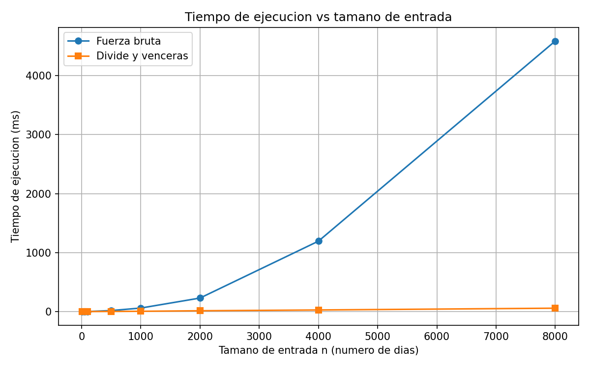

# Laboratorio evaluativo 02 — Dividir y vencer

**Autora:** Juliana Arroyave Arango

## Cómo reproducir el experimento

Desde la raíz del repositorio, con el entorno virtual activado:

```
pip install -r requirements.txt
cd lab2-divide-y-vencer
python pruebas.py
python medicion.py
```

- `python pruebas.py` ejecuta las pruebas y, si todo está bien, imprime `Todas las pruebas pasaron`.
- `python medicion.py` corre el experimento, imprime la tabla de tiempos y guarda la gráfica en `graficas/tiempo_vs_n.png`.

## Parte 1 — Implementación y verificación

Código: [subarreglo.py](subarreglo.py) y [pruebas.py](pruebas.py).

Verifiqué las dos soluciones con `assert` en `pruebas.py`, comparando siempre la **suma** del mejor tramo y no los índices, ya que cuando hay empates cualquier tramo es válido. Los casos cubiertos son:

- La serie de ocho días de la situación problema (suma 17).
- Una serie de un solo elemento.
- Una serie con todos los valores negativos.
- Una serie con todos los valores positivos.
- Un caso donde el mejor tramo cruza el punto medio, probado con `subarreglo_maximo` y también con `suma_cruzada` por separado.
- Una comprobación de que ninguna función modifica la lista recibida.
- 30 listas aleatorias (semilla fija 42, tamaños de 1 a 40, enteros entre -100 y 100) donde ambas funciones deben dar la misma suma.

## Parte 2 — Medición

Código: [medicion.py](medicion.py).



**Cómo medí:**

- Probé ocho tamaños de entrada: 10, 50, 100, 500, 1000, 2000, 4000 y 8000.
- Generé los datos con semilla fija (42) y enteros entre -100 y 100, y usé la misma lista para ambos algoritmos en cada tamaño.
- Cronometré únicamente la llamada al algoritmo con `time.perf_counter()`, sin incluir la generación de datos.
- Repetí cada medición tres veces y usé la mediana para reducir el ruido del sistema operativo.
- Dentro del mismo experimento verifiqué que, en cada tamaño, ambos algoritmos devolvieran la misma suma.

**Tiempos medidos (ms):**

| n    | Fuerza bruta | Divide y vencerás |
|-----:|-------------:|------------------:|
| 10   | 0.012        | 0.045             |
| 50   | 0.120        | 0.173             |
| 100  | 0.594        | 0.449             |
| 500  | 17.261       | 2.337             |
| 1000 | 59.935       | 4.867             |
| 2000 | 229.519      | 13.935            |
| 4000 | 1194.102     | 27.141            |
| 8000 | 4587.053     | 57.292            |

## Parte 3 — Análisis

### 1. Recurrencia

`subarreglo_maximo` hace dos llamadas recursivas, cada una sobre la mitad del rango (n/2). Luego `suma_cruzada` hace dos barridos lineales que juntos recorren los n elementos, y comparar los tres candidatos cuesta O(1). Entonces:

T(n) = 2T(n/2) + Θ(n), con a = 2, b = 2 y f(n) = n.

Como n^(log₂2) = n y f(n) = Θ(n), ambos crecen igual. Aplica el caso 2 del método maestro y T(n) = Θ(n log n).

En fuerza bruta, para cada inicio i el algoritmo recorre los j ≥ i acumulando la suma, y cada paso cuesta O(1). El número de pares es n(n+1)/2, así que T(n) = Θ(n²).

### 2. Lo medido contra lo esperado

Al duplicar n, n² se multiplica por 4 y n log n por un poco más de 2 (≈ 2.17 entre 4000 y 8000).

Entre 4000 y 8000:

- Fuerza bruta: 4587.053 / 1194.102 = 3.84 (esperado ≈ 4).
- Divide y vencerás: 57.292 / 27.141 = 2.11 (esperado ≈ 2.17).

Ambos factores son cercanos a lo teórico. El 5.20 de fuerza bruta (2000 → 4000) es un valor atípico, probablemente ruido del sistema, porque cada punto es la mediana de solo tres repeticiones. Los otros dos saltos (3.83 y 3.84) están muy cerca de 4.

En la gráfica, la curva de fuerza bruta se dobla hacia arriba como una parábola. La de divide y vencerás casi parece una recta pegada al eje, con una pendiente leve que crece un poco más rápido que lineal.

### 3. Tamaños pequeños

| n   | Bruta (ms) | DyV (ms) |
|----:|-----------:|---------:|
| 10  | 0.012      | 0.045    |
| 50  | 0.120      | 0.173    |
| 100 | 0.594      | 0.449    |

El cambio ocurre entre n = 50 y n = 100. Esperaba que divide y vencerás ganara desde el principio por su menor complejidad, pero la notación asintótica ignora las constantes. La recursión hace 2n − 1 llamadas a función en total, y cada una de las n − 1 llamadas internas crea tuplas, calcula `medio`, llama a `suma_cruzada` y ejecuta `max` con una lambda. Cuando n es pequeño, ese costo fijo pesa más que lo que se ahorra, y los dos ciclos simples de fuerza bruta resultan más baratos. A partir de n ≈ 100, el término n² de fuerza bruta empieza a dominar.

### 4. ¿Cuándo conviene dividir?

Para hallar el máximo de un arreglo dividiéndolo a la mitad, combinar es solo comparar dos números, O(1):

T(n) = 2T(n/2) + Θ(1). Aquí n^(log₂2) = n y f(n) = 1 es menor, así que aplica el caso 1 y T(n) = Θ(n).

Es lo mismo que recorrer el arreglo una vez, pero con el costo extra de la recursión. Dividir no aporta nada aquí.

En el subarreglo máximo, combinar cuesta Θ(n), y aun así se pasa de Θ(n²) a Θ(n log n). Dividir conviene cuando el método directo es superlineal y el costo de combinar es menor que el trabajo que se evita al partir el problema.

### 5. Concepto para la gerente

**Recomendación:** divide y vencerás. Para series de miles de días o más es muchísimo más rápido, y su ventaja crece con n.

**Estimación** para n = 10⁶, calibrando una constante con la medición de n = 8000:

- Fuerza bruta (t ≈ c·n²): c = 4587.053 / 8000² ≈ 7.17×10⁻⁵ ms. Con n = 10⁶: 7.17×10⁻⁵ × 10¹² ≈ 7.17×10⁷ ms ≈ 20 horas.
- Divide y vencerás (t ≈ c·n·log₂n): c = 57.292 / (8000 × 12.97) ≈ 5.52×10⁻⁴ ms. Con n = 10⁶ (n·log₂n ≈ 1.99×10⁷): ≈ 1.1×10⁴ ms ≈ 11 segundos.

Fuerza bruta tardaría unas 6.5×10³ veces más. Es solo una estimación: supone que el modelo de crecimiento se mantiene y que las constantes medidas con n = 8000 son válidas. Ignora factores como el uso de memoria y caché (con un millón de datos), la profundidad de la recursión y el ruido del sistema, y parte de una medición con solo tres repeticiones.