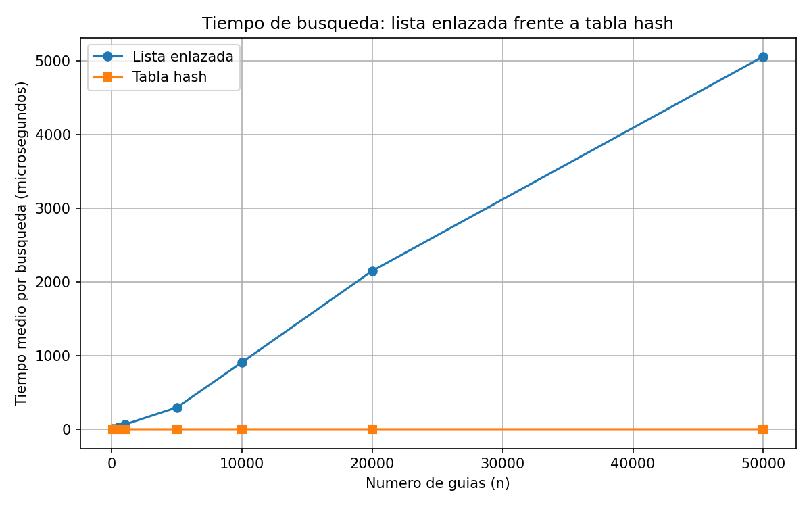
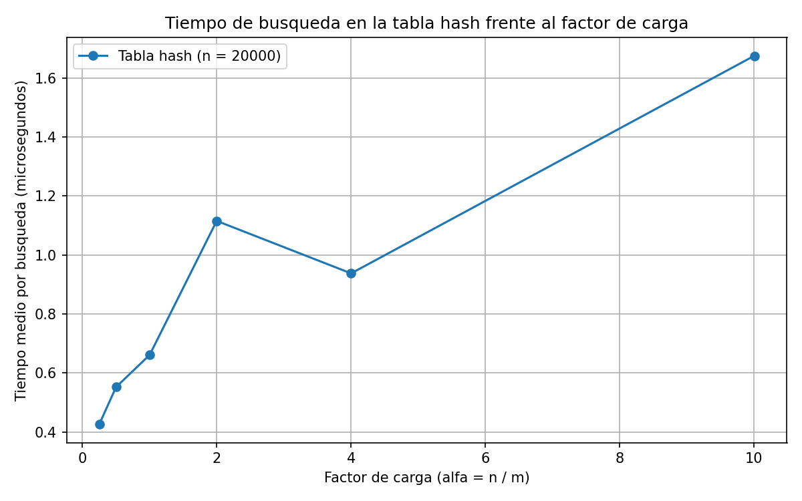

# Laboratorio 3 — Estructuras de datos

**Autora:** Juliana Arroyave Arango

## Cómo reproducir el experimento

Desde la carpeta `lab3-estructuras-datos/` del repositorio:

1. Activar el entorno virtual (ubicado en la raíz del repositorio):

   ```powershell
   ..\venv\Scripts\Activate.ps1
   ```

2. Instalar las dependencias (si hace falta):

   ```powershell
   pip install -r ..\requirements.txt
   ```

3. Ejecutar las pruebas:

   ```powershell
   python pruebas.py
   ```

   Si todo está bien, imprime `Todas las pruebas pasaron`.

4. Ejecutar la medición (genera las dos gráficas en `graficas/`):

   ```powershell
   python medicion.py
   ```

## Parte 1 — Implementación y verificación

Código: [estructuras.py](estructuras.py) y [pruebas.py](pruebas.py).

Implementé `ListaEnlazada` (inserción al inicio y búsqueda iterativa con `while`) y `TablaHash` (encadenamiento, función hash por división y factor de carga). La tabla reutiliza `ListaEnlazada` en cada casilla y no usa `dict`, `set` ni la función `hash()` de Python. Las pruebas de `pruebas.py` verifican:

- Una búsqueda exitosa y una infructuosa, tanto en la lista como en la tabla.
- La colisión forzada: con m = 7, las guías 10, 24 y 17 caen las tres en la casilla 3. Las tres se insertan y se buscan después, y la lista de esa casilla tiene longitud 3.
- Que `factor_carga()` da 3/7 tras esas tres inserciones.
- 25 colecciones aleatorias (semilla fija) en las que, para guías existentes y para guías inexistentes, la lista y la tabla devuelven lo mismo.

## Parte 2 — Medición y gráficas

Código: [medicion.py](medicion.py).

### Cómo medí

- Para cada valor de n, 200 búsquedas de guías **inexistentes**, que es el caso más lento para los operadores.
- Cada medición se repitió 3 veces y se promedió. Solo se cronometraron las búsquedas, con `time.perf_counter()`; la construcción de las estructuras y la generación de datos quedaron fuera del cronómetro.
- Semillas fijas: 42 para las guías existentes y 7 para las inexistentes. Lista y tabla usan exactamente las mismas guías en cada valor de n.
- Experimento A: n = 100, 500, 1.000, 5.000, 10.000, 20.000 y 50.000, con m primo cercano a n/2 (α ≈ 2).
- Experimento B: n = 20.000 fijo y m primo cercano a n/α para α = 0,25; 0,5; 1; 2; 4 y 10. Como m debe ser primo, el último α real es 10,01.
- Dentro del experimento verifiqué que, para una muestra de guías existentes, la lista y la tabla devuelven el mismo estado.
- Las mediciones son de microsegundos y tienen ruido del sistema operativo.

### Experimento A — Lista frente a tabla



| n | m | Lista (µs) | Tabla (µs) |
|---|---|-----------|-----------|
| 100 | 47 | 8,243 | 1,122 |
| 500 | 251 | 25,900 | 0,400 |
| 1000 | 499 | 64,902 | 0,690 |
| 5000 | 2503 | 295,590 | 0,494 |
| 10000 | 4999 | 909,484 | 0,751 |
| 20000 | 10007 | 2149,679 | 0,742 |
| 50000 | 24989 | 5056,966 | 0,692 |

### Experimento B — Efecto del factor de carga



| m | α | Tabla (µs) |
|---|---|-----------|
| 79999 | 0,25 | 0,426 |
| 40009 | 0,50 | 0,552 |
| 19997 | 1,00 | 0,661 |
| 10007 | 2,00 | 1,115 |
| 4999 | 4,00 | 0,937 |
| 1999 | 10,01 | 1,675 |

## Parte 3 — Análisis

1. **Costo teórico.** Buscar en la lista una guía que no existe obliga a revisar los n nodos, porque solo al llegar al final puedo decir “no está”: Θ(n). En la tabla calculo la casilla con guia % m (costo constante, el “1”) y recorro solo su lista, que en promedio tiene α = n/m nodos, así que el costo es Θ(1 + α). Esto supone que la función hash reparte las guías de forma uniforme entre las casillas. Si todas cayeran en la misma casilla, la tabla sería una sola lista de n nodos y el costo volvería a Θ(n). Con m = 7, las guías 10, 24 y 17 caen las tres en la casilla 3, un ejemplo en miniatura de esa peor situación. En el experimento A uso m ≈ n/2, así que α se mantiene cerca de 2 aunque n crezca.

2. **Lo medido contra lo esperado.** En la lista, el tiempo pasa de 295,6 µs (n = 5.000) a 909,5 (10.000), 2149,7 (20.000) y 5057,0 µs (50.000). Entre 20.000 y 50.000, n se multiplica por 2,5 y el tiempo por ≈2,35; entre 10.000 y 20.000, n por 2 y el tiempo por ≈2,36. Eso es casi proporcional, coherente con Θ(n). El salto de 5.000 a 10.000 (×3,08 con n ×2) se aleja más, probablemente por efectos de memoria caché, no por la complejidad. En la tabla, el tiempo oscila entre 0,4 y 1,1 µs sin tendencia clara al crecer n, coherente con Θ(1) con α fijo. En el experimento B (n = 20.000), α crece unas 40 veces (0,25 a 10,01), pero el tiempo solo pasa de 0,426 a 1,675 µs, unas 4 veces. Es coherente con Θ(1 + α): hay un costo fijo (≈0,4 µs) que no depende de α, y encima crece el costo del recorrido. La bajada en α = 4 (0,937 frente a 1,115 en α = 2) son fracciones de microsegundo, así que probablemente es ruido. Además, cada punto es una sola construcción de tabla.

3. **Colisiones.** Una colisión ocurre cuando dos guías distintas dan la misma casilla. Pasa aunque haya más casillas que guías, porque la función reduce números de diez dígitos a pocas casillas y, con datos que no controlo, no puedo garantizar que no choquen. Ejemplo: con m = 7, 10 % 7 = 3, 24 % 7 = 3 y 17 % 7 = 3. En el encadenamiento (el que implementé), cada casilla guarda una lista: nunca se llena y es simple, pero las listas largas se recorren despacio y los nodos consumen memoria extra. En el direccionamiento abierto, si la casilla está ocupada se busca otra dentro del mismo arreglo: no necesita nodos, pero cuando α se acerca a 1 la tabla se llena, las búsquedas se alargan y hay que redimensionarla.

4. **Tabla hash o árbol.** Para “guías entre X y Y”, la tabla no sirve: la función hash dispersa las guías, y guías consecutivas no quedan en casillas vecinas, así que tendría que revisar toda la tabla. Un ABB deja las guías ordenadas por clave y el recorrido en orden las entrega de menor a mayor, así que el rango se obtiene de forma natural. Pero si las 400.000 guías llegan ya ordenadas y se insertan una a una, cada una va siempre al mismo lado y el árbol degenera en una cadena de altura ≈ 400.000, con búsquedas del orden de 400.000 comparaciones. Si estuviera equilibrado, la altura sería ≈ log₂(400.000) ≈ 19 y una búsqueda costaría unas 19 comparaciones, unas 21.000 veces menos. Por eso conviene un árbol equilibrado (AVL o rojinegro), no un ABB simple.

5. **Concepto para la jefa de operaciones.** Recomiendo combinar dos estructuras: una tabla hash para la consulta puntual, porque ofrece costo casi constante, y un árbol de búsqueda equilibrado para el monitoreo por rango, porque mantiene las guías ordenadas. Una sola no cubre ambas: la tabla no soporta rangos y el árbol es más lento en consultas puntuales. El costo es más memoria y mantener ambas actualizadas en cada inserción. Esto es una estimación, no una medición. Para la lista, mi costo por guía se estabiliza (≈0,10 µs en n = 20.000 y 50.000), y como una búsqueda inexistente recorre los n nodos, el tiempo es proporcional a n: 5.000.000 × 0,10 µs ≈ 0,5 s, probablemente algo más por la caché. Para la tabla, el costo depende de α y no de n: si m crece con n y mantengo α ≈ 2, el tiempo seguiría en ≈1 µs. Para el árbol equilibrado, log₂(5.000.000) ≈ 22 comparaciones.